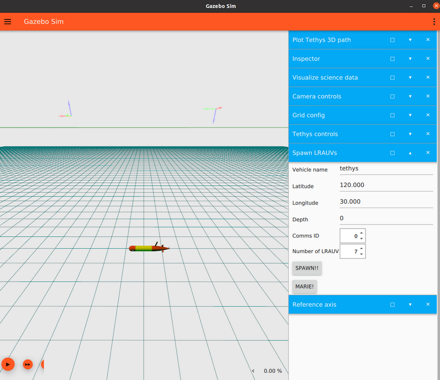

# LRAUVSim Benchmark

This folder contains the benchmarking code to evaluate the performance of the [LRAUV Simulator (LRAUVSim)](https://github.com/osrf/lrauv) using the LRAUV underwater vehicle model. Each scenario simulates multiple LRAUV agents under a Gaussian underwater current of 0.5 m/s.

Two benchmarking modes are available:

- **Real-time** — Gazebo runs at real-time speed (RTF = 1)
- **Accelerated-time** — Gazebo runs as fast as possible (RTF uncapped)

The `gazebo_source_files/` folder contains modified Gazebo Garden source files required to export per-step metrics. The `lrauv_gazebo_plugins_source_files/` folder contains modified LRAUV plugin files that add the agent spawning UI and configure the underwater current. The `lrauv_ws/` folder is the colcon workspace containing the LRAUV submodule.

```text
├── gazebo_source_files/                   # Modified Gazebo Garden source files
│   ├── MainWindow.cc                      # GUI modification (fps logging)
│   ├── WorldStats.cc                      # Physics stats modification (rtf, update_times logging)
│   └── WorldStats.hh
├── lrauv_gazebo_plugins_source_files/     # Modified LRAUV plugin files
│   ├── SpawnPanelPlugin.cc / .qml         # Adds the "Spawn LRAUVs" UI panel
│   ├── HydrodynamicsPlugin.cc             # Sets underwater current (default: 0.5 m/s)
│   ├── empty_environment.sdf              # World file with benchmark physics settings
│   └── model.sdf                          # LRAUV model (sensors/actuators config)
└── lrauv_ws/
    └── src/
        ├── lrauv/                         # LRAUV simulator (submodule)
        └── gz/                            # Gazebo message bindings
```

---

## Summary

- [1. Simulation Configuration](#1-simulation-configuration)
- [2. Installation](#2-installation)
- [3. Set a Benchmark Mode](#3-set-a-benchmark-mode)
- [4. Launch LRAUVSim Benchmark](#4-launch-lrauvsim-benchmark)

---

## 1. Simulation Configuration

All benchmarks were run with the following hardware and software:

| **Specification** | **Value** |
|--------------------|-----------|
| Operating System | Ubuntu 20.04 LTS |
| Processor | 13th Gen Intel(R) Core(TM) i9-13980HX |
| RAM | 64 GB |
| GPU | NVIDIA GeForce RTX 4090 Laptop (16 GB VRAM) |
| NVIDIA Driver | 570.133.07 |
| CUDA Version | 13.0 |
| Python Version | 3.8.10 |
| Gazebo Version | Garden |

---

## 2. Installation

### 2.1 Install Gazebo Garden from source

Gazebo must be built from source because we need to modify and recompile it to export per-step metrics. Follow the [official Gazebo Garden source installation guide](https://gazebosim.org/docs/garden/install_ubuntu_src/) for Ubuntu 20.04.

After completing the guide you will have a workspace (referred to as `<gz_workspace>` below) with Gazebo built and installed.

### 2.2 Initialize the submodule

The workspace depends on the `lrauv` submodule. If you cloned the repository without `--recurse-submodules`, initialize it now:

```bash
# From the root of the repository
git submodule update --init benchmark_code/lrauvsim_benchmark/lrauv_ws/src/lrauv
```

### 2.3 Modify and rebuild Gazebo Garden

Gazebo must be recompiled with modified source files so that it exports per-step metrics (`rtf.csv`, `update_times.csv`, `fps.csv`) to `~/` during simulation.

**Step 1** — Copy the modified files from this repository into the Gazebo source tree, replacing the originals:

| File | Destination in Gazebo workspace |
|------|---------------------------------|
| `gazebo_source_files/MainWindow.cc` | `<gz_workspace>/src/gz-gui/src/` |
| `gazebo_source_files/WorldStats.cc` | `<gz_workspace>/src/gz-gui/src/plugins/world_stats/` |
| `gazebo_source_files/WorldStats.hh` | `<gz_workspace>/src/gz-gui/src/plugins/world_stats/` |

```bash
GZ_WS=<gz_workspace>   # replace with your actual path

cp benchmark_code/lrauvsim_benchmark/gazebo_source_files/MainWindow.cc \
   $GZ_WS/src/gz-gui/src/

cp benchmark_code/lrauvsim_benchmark/gazebo_source_files/WorldStats.cc \
   benchmark_code/lrauvsim_benchmark/gazebo_source_files/WorldStats.hh \
   $GZ_WS/src/gz-gui/src/plugins/world_stats/
```

**Step 2** — Rebuild Gazebo (only the GUI component needs rebuilding):

```bash
cd <gz_workspace>
colcon build --packages-select gz-gui7 --merge-install
```

**Step 3** — Add the following line to `~/.bashrc` so Gazebo is sourced in every new terminal:

```bash
. <gz_workspace>/install/setup.bash
```

> After this setup, Gazebo will write three CSV files to `~/` during each simulation run:
> - `rtf.csv` — real-time factor at each simulation step
> - `real_update.csv` — physics engine update duration
> - `render_fps.csv` — frames per second at each step

### 2.4 Apply the modified LRAUV plugin files

Copy the modified plugin files from `lrauv_gazebo_plugins_source_files/` into the LRAUV submodule, replacing the originals:

| File | Destination |
|------|-------------|
| `SpawnPanelPlugin.cc` | `lrauv_ws/src/lrauv/lrauv_gazebo_plugins/src/` |
| `SpawnPanelPlugin.qml` | `lrauv_ws/src/lrauv/lrauv_gazebo_plugins/src/` |
| `HydrodynamicsPlugin.cc` | `lrauv_ws/src/lrauv/lrauv_gazebo_plugins/src/` |
| `empty_environment.sdf` | `lrauv_ws/src/lrauv/lrauv_gazebo_plugins/worlds/` |
| `model.sdf` | `lrauv_ws/src/lrauv/lrauv_description/models/tethys_equipped/` |

```bash
LRAUV_WS=benchmark_code/lrauvsim_benchmark/lrauv_ws
PLUGINS_SRC=benchmark_code/lrauvsim_benchmark/lrauv_gazebo_plugins_source_files

cp $PLUGINS_SRC/SpawnPanelPlugin.cc $PLUGINS_SRC/SpawnPanelPlugin.qml \
   $PLUGINS_SRC/HydrodynamicsPlugin.cc \
   $LRAUV_WS/src/lrauv/lrauv_gazebo_plugins/src/

cp $PLUGINS_SRC/empty_environment.sdf \
   $LRAUV_WS/src/lrauv/lrauv_gazebo_plugins/worlds/

cp $PLUGINS_SRC/model.sdf \
   $LRAUV_WS/src/lrauv/lrauv_description/models/tethys_equipped/
```

To change the underwater current speed, edit `HydrodynamicsPlugin.cc` before copying:

```cpp
/// \brief Water current [m/s].
public: gz::math::Vector3d waterCurrent {0.5, 0.0, 0.0};
```

---

## 3. Set a Benchmark Mode

To select which sensors and actuators are active, edit:

```
lrauv_ws/src/lrauv/lrauv_description/models/tethys_equipped/model.sdf
```

Open the world file to set the benchmark mode:

```
lrauv_ws/src/lrauv/lrauv_gazebo_plugins/worlds/empty_environment.sdf
```

### Real-time mode

```xml
<physics name="default" type="dart">
    <max_step_size>0.03</max_step_size>
    <real_time_update_rate>33.33</real_time_update_rate>
    <real_time_factor>1.0</real_time_factor>
</physics>
```

---

## 4. Launch LRAUVSim Benchmark

Before launching a benchmark run:

- Close all other windows and applications
- Disconnect from the internet
- Disconnect any additional display (second screen...)
- Set the GPU through NVIDIA to performance

### Build and launch

```bash
cd benchmark_code/lrauvsim_benchmark/lrauv_ws
colcon build
# If only the LRAUV plugins were changed, a faster partial rebuild is enough:
# colcon build --packages-select lrauv_gazebo_plugins
source install/setup.bash
gz sim empty_environment.sdf
```

> `colcon build` is only needed the first time or after modifying source files.

### Spawning agents via the UI

Once Gazebo opens, use the **Spawn LRAUVs** panel on the right-hand side:

1. Enter the desired number of LRAUVs
2. Click **`Marie!`** to spawn them into the world
3. Press **`Play`** (bottom-left) to start the simulation



### Collecting benchmark data

After each simulation run, Gazebo writes `real_update.csv`, `rtf.csv`, and `render_fps.csv` to `~/`. Move them into the benchmark results folder, organised by agent count:

```bash
N=<n_agents>   # replace with the number of LRAUVs spawned
DEST=benchmark_results/gazebo_based/src/benchmark_results/benchmark_lrauv/data/lrauvsim/$N

mkdir -p $DEST
mv ~/real_update.csv ~/rtf.csv ~/render_fps.csv $DEST/
```

Once data is collected for all agent counts, run `process_lrauvsim.py` from the `benchmark_lrauv/` folder to regenerate the summary CSV:

```bash
cd benchmark_results/gazebo_based/src/benchmark_results/benchmark_lrauv
python process_lrauvsim.py
```
